# Klatchly

**Unofficial self-hosted web client for Beeper and more**

<p align="center">
  <picture>
    <source media="(prefers-color-scheme: dark)" srcset="docs/screenshots/16-dark-inbox.png">
    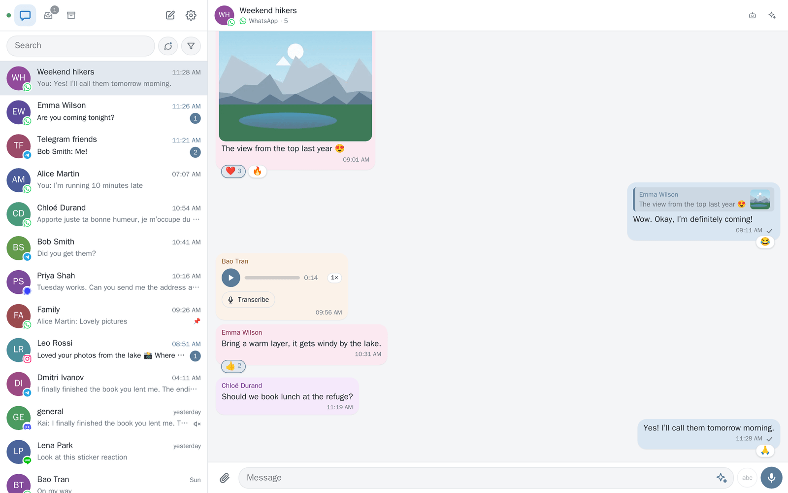
  </picture>
</p>

> **Unofficial project.** Klatchly is an independent, community-made web client for
> [Beeper](https://www.beeper.com). It is not affiliated with, endorsed by, or supported by
> Beeper or Automattic Inc.

Klatchly puts your Beeper inbox in a browser tab. It runs on your own server, next to the official headless
**beeper-server** (Beeper's Linux server build, which exposes the
[Beeper Desktop API](https://developers.beeper.com/desktop-api/)), and serves a fast, installable web app that only
you can sign in to. The browser talks to your Klatchly server, which talks to your beeper-server over a private
Compose network: your chats pass through no third-party service, unless you turn on an extension that sends text to
a model provider you configured (Settings say which, and what is sent).

Klatchly is more than a window on your inbox. Optional extensions add tools around your chats: writing help and
translation on the model provider of your choice, voice notes turned into text, AI agents you can bring into a
conversation, and a dashboard of your connected accounts. Each one is a package you choose to build in, and you can
write your own (see [Packages and extensions](#packages-and-extensions)).

It is a single-user app: one Beeper account, one owner, any number of the owner's devices.

## Features

- **All your networks in one list**: every chat Beeper bridges (WhatsApp, Signal, Telegram, Instagram, Messenger,
  LinkedIn…), with a filter by network, search, unread filter, archive, pin, mute and a low-priority inbox.
- **Live**: new messages, reactions, edits and read receipts arrive over a WebSocket; Web Push notifications when no
  tab is open, quiet hours, and a local copy of recent chats so the app opens instantly.
- **Messaging**: text with mentions and drafts, replies, reactions, edit and delete your own messages, photos,
  videos, files and voice messages, albums, forward to several chats, discreet reading (read without sending a
  receipt where the network allows it).
- **Formatting**: bold, italic, strikethrough, code, quotes, links and lists from shortcuts (Ctrl/⌘+B, I…) or a
  formatting bar, limited to what the chat's network displays; rich text pasted from documents or web pages keeps its
  formatting, and a live preview in the field on desktop.
- **Media**: full-screen viewer, a per-chat gallery of media, files and links, server-side thumbnails.
- **Installable**: a Progressive Web App that behaves like a native app on iPhone and Android home screens, and on
  desktop.
- **Languages**: English and French interface; translations are typed catalogs (one file per language).
- **Extensions**: features come as packages built into the image (see below): a connected-accounts dashboard,
  writing help and translation on any OpenAI-compatible model provider you configure, and your own packages.

<table>
  <tr>
    <td width="50%"><a href="docs/screenshots/04-writing-correction.png">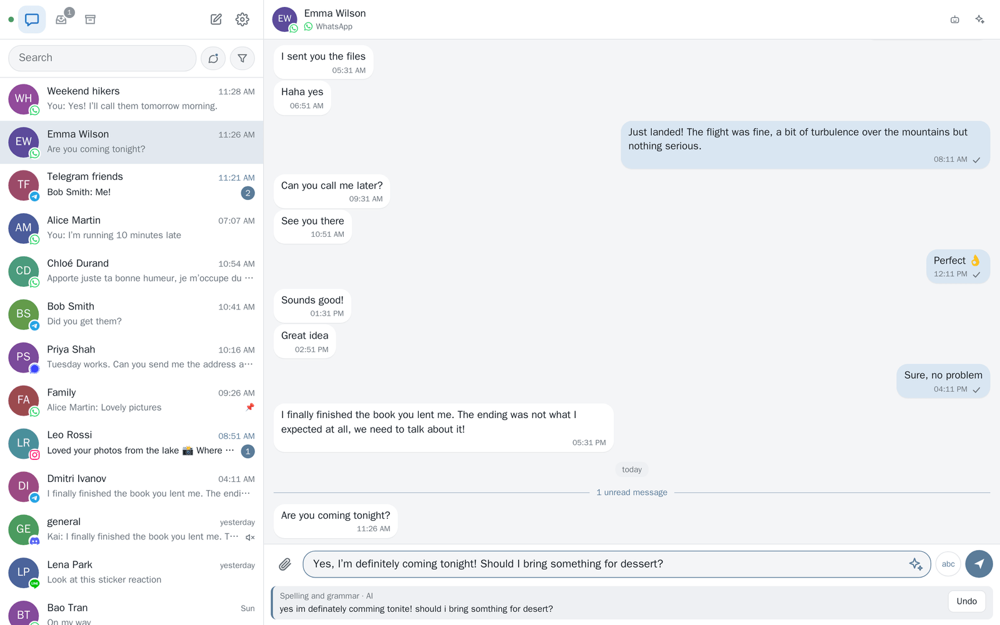</a><br><sub><b>Writing help</b>: fix or translate a draft in the chat's language and tone.</sub></td>
    <td width="50%"><a href="docs/screenshots/05-translate-message.png">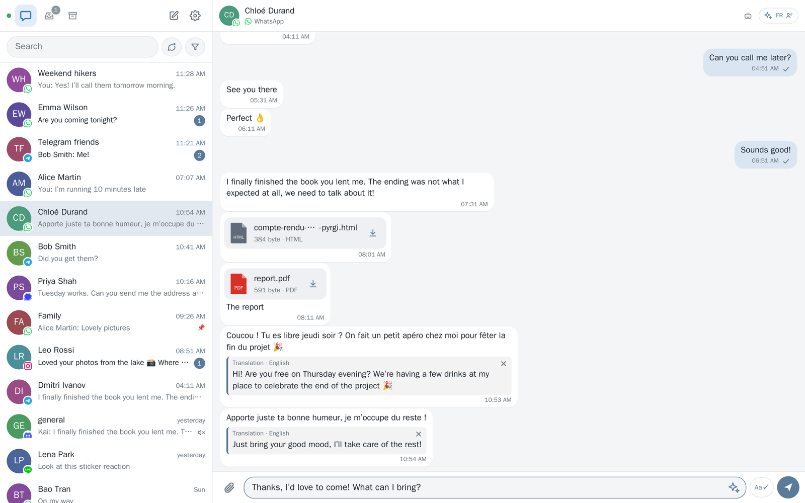</a><br><sub><b>Translation</b> of received messages, in place.</sub></td>
  </tr>
  <tr>
    <td width="50%"><a href="docs/screenshots/07-transcribe.png">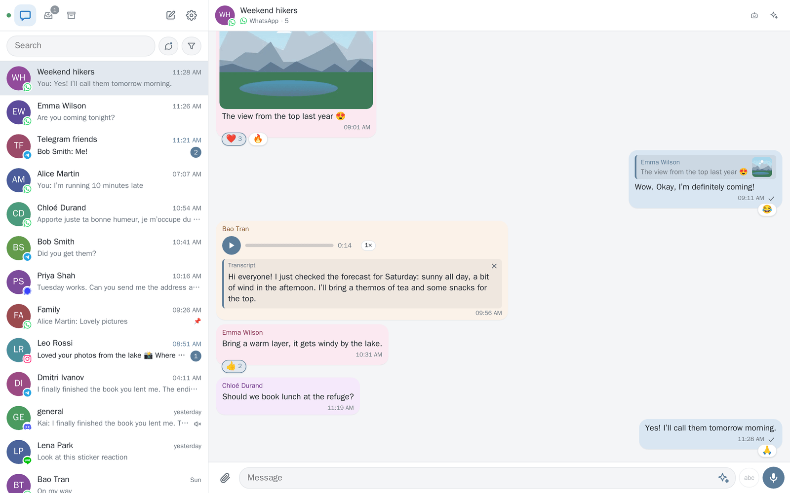</a><br><sub><b>Voice notes</b> to text, on demand.</sub></td>
    <td width="50%"><a href="docs/screenshots/08a-agent-draft.png">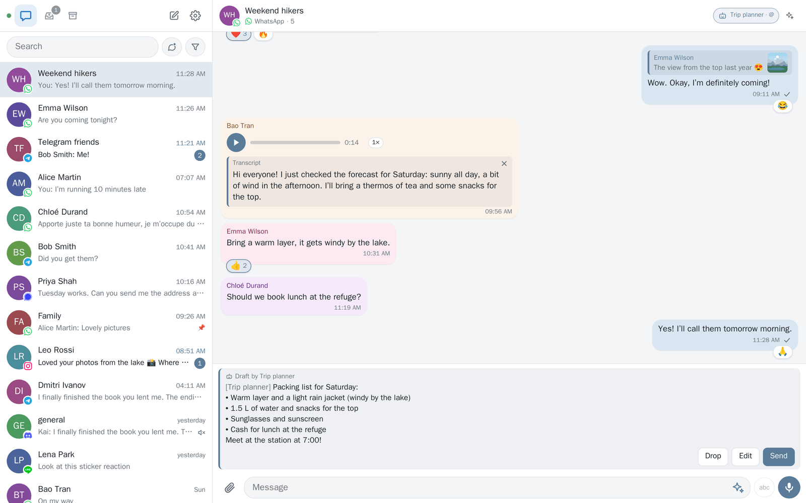</a><br><sub><b>Agents</b> in a chat: they propose, you decide what is sent.</sub></td>
  </tr>
</table>

<details>
<summary><b>More screenshots</b></summary>
<br>
<table>
  <tr>
    <td width="33%">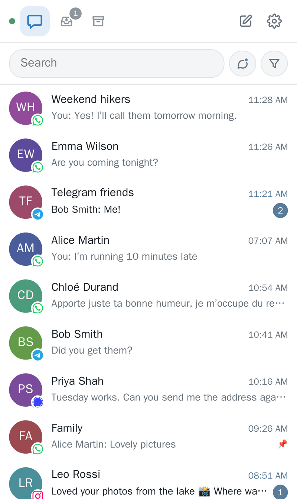<br><sub>Phone: chat list</sub></td>
    <td width="33%">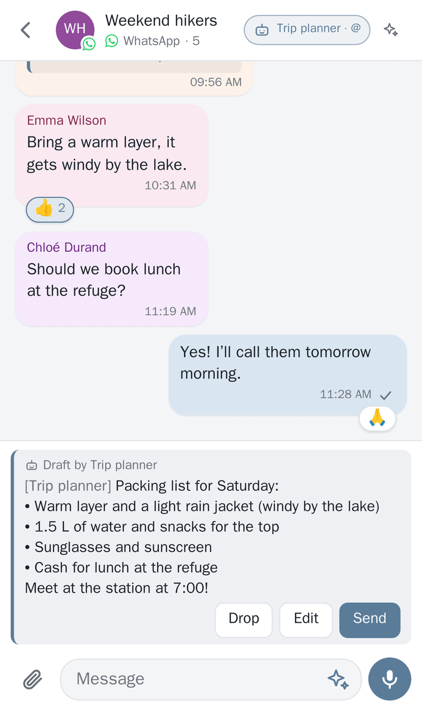<br><sub>Phone: conversation</sub></td>
    <td width="33%">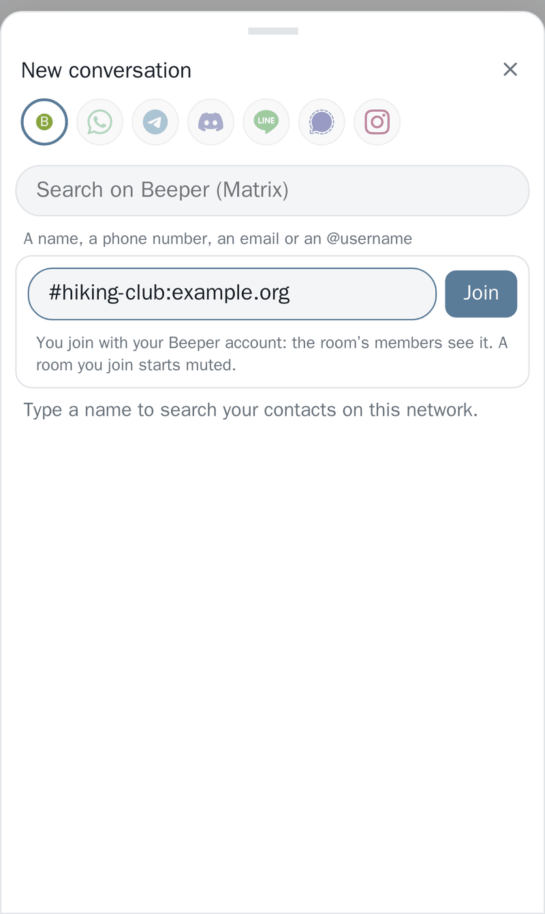<br><sub>Phone: new chat and Matrix rooms</sub></td>
  </tr>
  <tr>
    <td width="33%">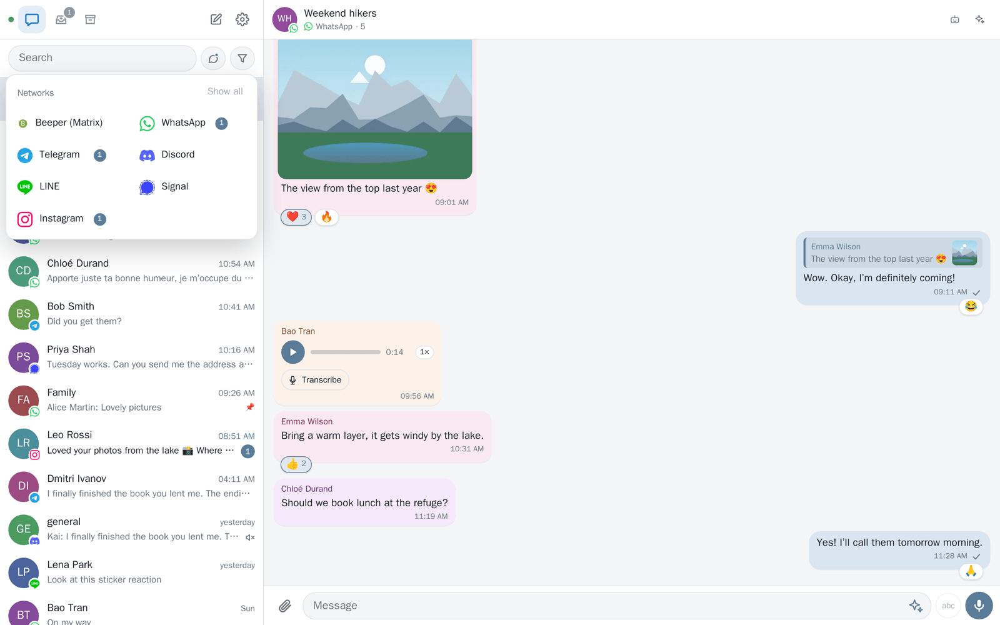<br><sub>Filter by network</sub></td>
    <td width="33%">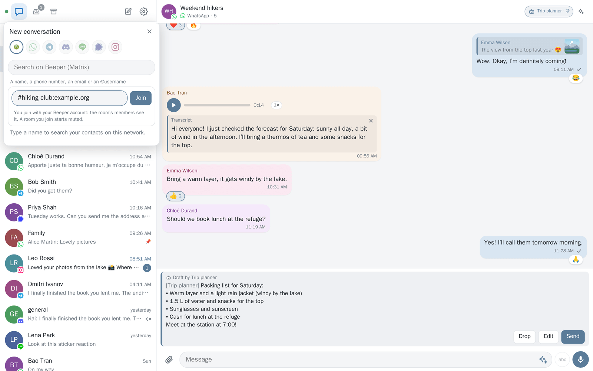<br><sub>Join a Matrix room</sub></td>
    <td width="33%">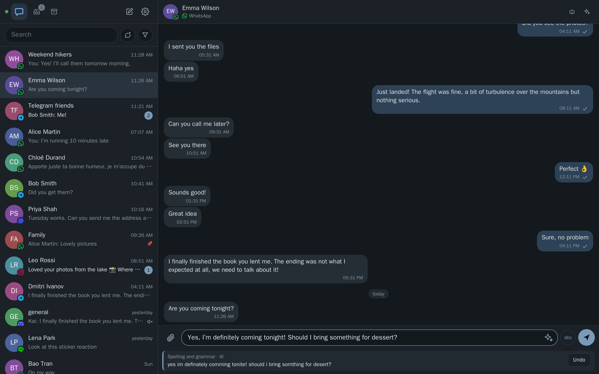<br><sub>Dark theme</sub></td>
  </tr>
</table>

All screenshots, with captions: [docs/screenshots](docs/screenshots/README.md).
</details>

## Requirements

- A Linux host with Docker Engine and the Compose plugin (x86-64: beeper-server is published for `linux-x64`).
- A Beeper account.
- A domain name and a reverse proxy that terminates TLS (an example for Caddy is in `deploy/Caddyfile.example`), or a
  tunnel such as Cloudflare Tunnel. HTTPS is required: passkeys and Web Push only work on a secure origin.
- About 2 GB of RAM for the two containers.

## Quick start

```sh
git clone <this repository> klatchly && cd klatchly
cp .env.example .env              # set KLATCHLY_ORIGIN, KLATCHLY_RP_ID, BEEPER_TOKEN_PATH, KLATCHLY_UID/KLATCHLY_GID
docker compose config             # check the resolved configuration; changes nothing
docker compose build              # builds both images locally (beeper-server is downloaded from Beeper here)
```

1. **Sign beeper-server in to your Beeper account** and write its access token to the file named by
   `BEEPER_TOKEN_PATH` (mode 0400, owned by `KLATCHLY_UID`). A beeper-server that is not signed in yet lets anyone who
   can reach it sign it in to *their* account: never publish its port. _(The step-by-step guide is being
   translated; see `docs/self-hosting.md`.)_
2. **Start**: `docker compose up -d`.
3. **Point your reverse proxy** at `127.0.0.1:${KLATCHLY_PORT}` (`deploy/Caddyfile.example`) and add its address to
   `KLATCHLY_TRUSTED_PROXIES`.
4. **Enroll your first passkey**: `docker compose exec klatchly /nodejs/bin/node /app/dist/cli.js enroll` prints a
   one-time code; open `https://<your host>/enroll` and enter it.

Configuration reference (every variable, `compose.override.yml` examples, reverse-proxy notes):
[docs/self-hosting.md](docs/self-hosting.md).

## Signing in

There is always authentication; there is no "open" mode.

- **Passkeys** (built in, the default): WebAuthn with discoverable credentials and user verification. A new device
  enrolls with a one-time code from the server CLI, or from Settings on a device that is already signed in. Every
  new passkey is announced to your other devices.
- **OpenID Connect provider** (optional, `KLATCHLY_OIDC_*`): "Continue with <provider>" next to the passkeys; your
  provider decides how you authenticate (passkey, password + TOTP, …). Authorization code + PKCE, and only the pinned
  issuer + subject is let in, never an e-mail match. Keep a passkey as a fallback.

Settings → General → Sign-in lists your passkeys and signed-in devices; you can sign any of them out.

## Packages and extensions

Everything beyond the core is a **package** (`web/ext/<id>/`), composed into the image **at build time**: nothing is
loaded at run time. The default list is `web/ext/packages.json`; `KLATCHLY_PACKAGES` in `.env` overrides it, and packages
from another folder are added through a Docker build context (see `docs/self-hosting.md`).

| Package | What it does |
|---|---|
| `beeper` | The Beeper Desktop API connector (required: the core does not start without a connector). |
| `accounts` | Settings → Networks: the messaging accounts of every connector and their status. |
| `llm` | OpenAI-compatible model providers (the server's own from `.env`, more added in Settings). |
| `writing` | Writing help (fix, translate the draft) and translation of received messages, on `llm`. |
| `agents` | Conversations with your agents, and an agent that can follow a chat and write there (on `llm`). |
| `transcribe` | Voice notes to text on demand, with NVIDIA Riva or an OpenAI-compatible speech-to-text provider. |
| `example` | A small, commented reference package for authors. Not built in by default. |

Writing your own package: [docs/extensions.md](docs/extensions.md) (guide) and
[docs/extension-api.md](docs/extension-api.md) (API reference and changelog).

**A package runs inside the Klatchly server process, with all of its rights**, including the Beeper token. Its
declared capabilities (network, files, listeners, processes) are checked at build time and shown in Settings →
Extensions, but they are not a sandbox. Only build in packages whose code you have read, pinned to a commit.

## Security notes

- Putting on the internet an interface that gives access to all your messages is not something to do lightly.
  If you choose to, you are responsible for securing it properly: keep the server and its images up to date, use
  strong authentication (passkeys), restrict who can reach it where you can (VPN, private network, Cloudflare Access
  or an IP allow-list in front of the reverse proxy), and watch its logs.
- The Beeper token held by Klatchly is your account's Matrix access token: it can read every chat and send as you,
  on every network. Treat the server, its `secrets/` directory and its data volumes accordingly.
- beeper-server is never published: only Klatchly reaches it, over the Compose network. Klatchly itself listens on
  `127.0.0.1` behind your reverse proxy.
- Both containers run read-only, as an unprivileged uid of your choice, with all capabilities dropped and
  `no-new-privileges`.
- Your instance is for you alone: Beeper accounts are personal, so do not share an instance with other people.
- Report vulnerabilities as described in [SECURITY.md](SECURITY.md).

## Development

Klatchly is developed with heavy use of AI coding assistants. Every change still goes through the same gates: typechecking,
the unit and offline end-to-end tests, multi-reviewer passes on larger features, and the privacy and secret scans of the
public export. Bugs are ours either way, so please report them.

```sh
cd web
npm ci
npm run typecheck && npm test && npm run build
```

Node 24 is required. The tests never reach a real service (fake backends in the same process); the offline
end-to-end scripts run in a pinned Playwright container (`web/test/e2e/run-offline.sh`). Contributions: see
[CONTRIBUTING.md](CONTRIBUTING.md).

## Legal

- Klatchly talks to Beeper only through the public
  [Beeper Desktop API](https://developers.beeper.com/desktop-api/), which Beeper describes as
  experimental and recommends for personal use only.
- This repository does **not** contain or redistribute any Beeper software. The provided
  Dockerfile downloads the official `beeper-server` build from Beeper's servers when **you**
  build the image, and you use it under Beeper's own terms.
- You use your own Beeper account and are responsible for complying with the
  [Beeper Terms of Use](https://beeper.com/terms), the [Automattic Terms of Service](https://automattic.com/tos/)
  and the terms of every chat network you connect. Your Beeper account is personal: do not
  share your instance with other people.
- Exposing the Desktop API or this app to the internet can expose your chat history and let
  others send messages as you. Use strong authentication and a private network or tunnel.
- Sending too many messages may get your accounts suspended by the networks. Use at your own risk.

## Trademarks

Beeper is a trademark of Automattic Inc. Other product names and logos (shown through
[Simple Icons](https://simpleicons.org), CC0) are trademarks of their respective owners. Their use
here is only to identify compatible services and does not imply any endorsement.

## License

Klatchly is licensed under the [Apache License 2.0](LICENSE). The license does not grant permission to use the
Klatchly name or logo (section 6): a fork must use its own name. Third-party components keep their own licenses
(see [NOTICE](NOTICE)).
